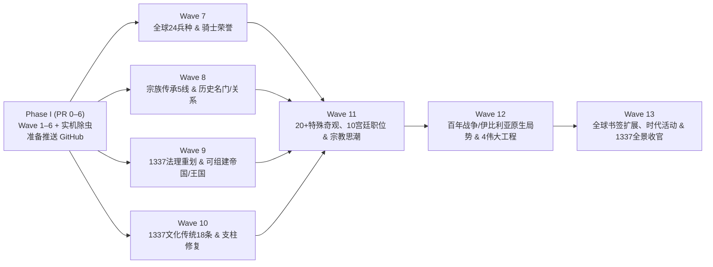

# 《Universalis Kings × Project Phoenix (PHX)》Phase I GitHub 推送准备 & Phase II 全 CK3 机制扩建总计划

> **目标仓库**：`https://github.com/hathaway682/EU5_1337_to_ck3`（上游当前 `origin/master` = `be08397`，与本机 `master` 完全一致，0 漂移）
> **游戏基线**：`Crusader Kings III 1.21.0.3 (Florin)`｜**授权前缀**：`phx`（`zz_phx_*` / `phx_*`）
> **编制日期**：2026-11-26｜**现状**：Phase I（PR 0 + Wave 1–6 + 独立原声带）已完成全部开发、首轮+二轮实机除虫（P1–P5、Q1、R1–R8）与 5 目标加强版静态校验 0 报错；Phase II 规划 7 个新波次（Wave 7–13）全面覆盖 CK3 核心机制。

---

## 第一部分：Phase I GitHub 推送准备与给作者的修改总账

### 1.1 拟推送分支总表（严格按模块拆分 PR，绝不直推 `master`）

> 所有 7 个 PHX PR 分支均干净基于 `origin/master@be08397`，合计 **71 文件、+27,003 / -27 行**（其中 65 个为纯新增 `zz_phx_*` / 原创 DDS 文件，4 个为恢复的 1337 原版地区大决议，1 个为 3 行微创修复，1 个为 `CREDITS.md` 署名追加），与作者主维护的新贸易商品、新殖民、朝圣、日本南北朝 **0 文件重叠**。

| 批次 | 本地分支 | Commit | 内容概要 | 变更规模 | 建议推送顺序 |
|---|---|---|---|---|---|
| **PR 0** | `fix/phx-roman-pentarchy-titles` | `2707697` | 修复 `80_major_decisions_roman.txt` 五大牧首区 3 处失效县 ID（`c_antakya` / `c_filastin`） | 1 文件 (+3/-3) | 第 1 批（极简热修） |
| **PR 1** | `feat/phx-wave1-byzantium-balkans` | `231a73f` | 东罗马 v1.0 旗舰 + 奥斯曼/巴尔干（40 事件、15 决议、28 修正、2 CB、1 内战故事线、4 张原创 `1100×440` DDS） | 12 文件 | 第 1 批（旗舰样本） |
| **PR 2** | `feat/phx-wave2-yuan-red-turban` | `091478a` | 大元与红巾军 v1.0（CK3 `1.21` 原生局势 `phx_red_turban_rebellion` + 8 催化剂、贾鲁治河伟大工程、2 故事线、1 解放 CB、32 事件、13 决议、20 修正、2 张原创 DDS） | 15 文件 | 第 1 批（旗舰样本） |
| **PR 3** | `feat/phx-wave3-hundred-years-war` | `a840d66` | 百年战争与西欧（26 事件、10 决议、16 修正、2 CB、1 多代故事线、1 张原创 DDS） | 10 文件 | 第 2 批 |
| **PR 4** | `feat/phx-wave4-north-east-and-decisions` | `e8a44ce` | 条顿/马尔堡高堡伟大工程/神罗/波立/罗斯（24 事件、11 决议、17 修正、1 张原创 DDS）+ **4 个 1337 适配恢复的原版地区大决议文件（24 条决议）** | 14 文件 | 第 2 批 |
| **PR 5** | `feat/phx-wave5-global-crises-eurasia` | `d554cbc` | 1347 黑死病（无 DLC011 兼容）、1368 帖木儿故事线、1378 西方大分裂、欧亚非亮点（41 事件、12 决议、21 修正、5 张原创 DDS） | 14 文件 | 第 3 批 |
| **PR 6** | `feat/phx-wave6-flavor-maa-artifacts` | `d3ae2fc` | 36 条 1337 全球称谓风味化、6 个时代常备军兵种、12 件开局历史神器 + 12 神器修正 | 6 文件 | 第 3 批 |
| **可选上游修补 PR（需作者同意再提）** | `fix/restore-gen-wilderness-faith` (`45cd0b7`) `fix/suppress-guelph-ghibelline-1337` (`f4660c3`) `fix/suppress-1337-vanilla-noise-f9` (`d2a9896`) | 独立 3 分支 | 实机 QA 排查出的 3 个上游高噪音报错修补（**F1** 补回合并丢失的 `gen_wilderness_faith` 消 52,903 条开局报错；**F8** 屏蔽 1337 不存在的 1066/1178 意大利家族消 ~5 万条/5年；**F9** 适配 `c_roma→c_marittima`、`c_byzantion→c_constantinople` 与 `court_language_ai_score` 空首都守卫消 ~3.5 万条/30年）。**均独立存放，未混入任何 PHX PR。** | 10 文件 | 征得作者同意后单提 |
| **独立子模组（不并入主库）** | `soundtrack_submod/` | 本地独立目录 | *PHX 欧亚交响原声带*：20 首 100% 原创 `.ogg`（13.0 MB）+ 原创 `648×376` 播放器封面 DDS + 双语词条 | 26 文件 | 单独发工坊或独立库 |

> **绝不推送项**：`dev_test/`（本地 QA 面板）、`dev_obs_base/`（A 侧观战记录器）、`qa/*`（本地合流测试分支）、`reports/`。

### 1.2 GitHub 推送前检查与两条安全路径

1. **当前 GitHub 状态（只读实测）**：
   - `hathaway682/EU5_1337_to_ck3`：`default_branch = master`，HEAD = `be08397`（与本机一致）。
   - `miscos330/EU5_1337_to_ck3`：**HTTP 404（尚未创建 Fork）**。
2. **推送前最后一道门禁（建议）**：
   - 建议先等 **Claude 跑完第 3 轮最终 30 年实机复测**（确认 R1–R8 归零且大元平衡恢复），再一次性推上 GitHub；
   - 如果想先给作者看核心代码，也可以先推 **PR 0 + PR 1 + PR 2**，其余 PR 等 30 年复测全绿后再推。
3. **两条可选推送路径（待你确认选哪条）**：
   - **路径 A（推荐，最安全规范）**：你在 GitHub 网页点一下 Fork `hathaway682/EU5_1337_to_ck3` 到 `miscos330/EU5_1337_to_ck3` → 本地添加 `fork` 远程 → 推送 7 个 PR 分支到 `fork` → 向 `hathaway682/EU5_1337_to_ck3:master` 逐个提 Pull Request（完全不污染作者仓库分支列表）。
   - **路径 B（协作者直推特性分支）**：如果你已被作者加为 `hathaway682/EU5_1337_to_ck3` 协作者，可直接推送 `fix/phx-*` / `feat/phx-*` 特性分支到 `origin` 再开 PR（**严禁直推 `origin/master`**）。
4. **给作者的完整中文修改说明稿**已同时落盘至 `[AUTHOR_PR_CHANGELOG_20261126.md](./AUTHOR_PR_CHANGELOG_20261126.md)`（可直接复制到 QQ / PR 描述中）。

---

## 第二部分：基于 `EU5_1337_to_ck3` 现状的 CK3 核心机制缺口审计

> 以下数据均基于 `phx/integration@0850578` 实盘扫描（2026-11-26），不是猜测：

| CK3 核心系统 | 当前仓库实盘状态 | 关键缺口与制作机会 |
|---|---|---|
| **兵种 (`men_at_arms_types`)** | 仅 1 个文件（我们 Wave 6A 的 6 支兵种） | 1337 晚中世纪—早期火药时代特色军制严重不足（缺法军宪兵骑士、胡斯战车、瑞士方阵、明军神机营/戚家先驱、元军怯薛重骑、波兰重骑、高丽火厢车、满者伯夷舰炮陆战队、马里索法骑兵、意大利雇佣兵等） |
| **家族与宗族传承 (`dynasties` / `houses` / `dynasty_legacies` / `coat_of_arms`)** | 1,398 宗族 / 221 分支；**`dynasty_legacies` 0 文件**；**1,132 个宗族缺预设纹章** | 完全没有 1337 时代专属宗族传承线；核心名门缺历史箴言、历史关系与纹章修正（如 F4 坎塔库泽诺斯对安德洛尼卡三世开局好感 -100） |
| **开局法理架构（帝国/王国/公国/伯爵领）** | 6 霸权、107 帝国（93 顶层）、331 王国（104 头衔型）、1,975 公国（1,318 头衔型）、4,519 伯爵领、21,046 男爵领 | ① **638 个头衔缺 CoA/法理首都**；② 大量 1337 历史强权（大明、北元、奥斯曼、波立联邦、卡尔马、英法双重君主国、帖木儿、毗奢耶那伽罗、满者伯夷等）缺专属动态法理重划与可组建体系；③ 关键历史伯爵领/公国法理归属（如拜占庭—安纳托利亚、神罗—意大利、伊比利亚、中原—漠北）待校准 |
| **文化与文化传统 (`cultures` / `traditions` / `pillars`)** | 111 个文化；**仅 2 个自定义传统文件**；**570 条语言支柱缺颜色**；`gen_wilderness_culture` 缺 5 支柱 | 缺 1337 晚中世纪特色文化传统（雇佣兵契约、长弓自耕农、德夫希尔梅、江南科举、汉萨商站等）；关键文化（安纳托利亚土耳其、北意诸邦、罗斯诸公国、明清汉文化分支）缺 1337 历史分流/融合内容。（注：尊重作者 `no_innovation` 架构，不擅动 `innovations/`） |
| **特殊建筑与奇观 (`buildings`)** | `zz_eu5_special_building_locations.txt` **仅适配了 1 座**（罗马奥勒良城墙）！ | 圣索菲亚、阿维尼翁教皇宫、布拉格查理大学、克拉科夫瓦维尔、克里姆林宫、撒马尔罕雷吉斯坦、桑科雷大学、爱资哈尔、威尼斯兵工厂、加拉塔石塔、大都/应天皇城、亨比神庙等 20+ 座 1337 标志奇观几乎空白 |
| **宫廷职位 / 骑士荣誉 / 神器模板** | **`court_positions` 0 文件、`accolade_types` 0 文件、`artifacts/templates` 0 文件** | CK3 `1.21` 最能体现政体差异与角色扮演深度的三个系统目前完全空白 |
| **宗教与异端思潮 (`religion`)** | 仅 1 个美洲宗教文件 | 1337–1420 关键宗教运动（静修派、罗拉德派、胡斯运动前夜、白莲教弥勒信仰、立陶宛洗礼、波斯尼亚教会）缺教义/事件深度 |
| **原生局势 / 地区斗争 / 伟大工程** | 局势 3 个（含我们 Wave 2 红巾）；**斗争 0 个**；伟大工程 4 个（含我们贾鲁治河与马尔堡） | 百年战争、伊比利亚收复失地、北方十字军极适合升级为 CK3 `1.21` 原生局势/斗争；且可扩充 4 座时代伟大工程 |
| **1337 书签与活动 (`bookmarks` / `activities`)** | 6 个书签（主要集中在西欧/东罗/大元/日本） | 缺中东/印度/东南亚/非洲书签入口及 1337 特色时代互动（文艺复兴沙龙、大公会议、汉萨商盟大会） |

---

## 第三部分：Phase II 全 CK3 机制制作总计划（Wave 7 – Wave 13）

> **架构纪律（全程保持零冲突、可独立提 PR、100% EN+ZH 双语、全量通过加强版 `validate_mod.py`）**：
> - 所有增量文件统一使用 `zz_phx_*` 命名；**不动**作者正在维护的新贸易商品、新殖民（`zz_eu5_colonial_enterprise`）、朝圣、日本南北朝与 `no_innovation`。
> - 涉及改写上游大文件（尤其是 `00_landed_titles.txt` 与历史文件）的内容全部单独拆成 **「需作者审批的法理/历史校准子 PR」**，绝不与 `zz_phx_*` 增量内容混绑。

### Wave 7 — 全球 1337 时代兵种体系与骑士荣誉（`feat/phx-wave7-maa-accolades`）
- **目标**：把 1337 晚中世纪向早期火药过渡的军事风貌铺满欧亚非。
- **核心交付**：
  1. **新增 18 支区域特色常备军（连同 Wave 6A 共 24 支，`common/men_at_arms_types/zz_phx_1337_maa_expanded.txt`）**：
     - **欧洲**：法兰西王室宪兵重骑（`phx_maa_french_gendarmes`）、热那亚雇佣弩手（`phx_maa_genoese_crossbowmen`）、瑞士阿尔卑斯长矛方阵（`phx_maa_swiss_pikemen`）、波西米亚胡斯战车（`phx_maa_bohemian_war_wagons`）、意大利雇佣重骑（`phx_maa_italian_condottieri`）、伊比利亚轻骑兵（`phx_maa_iberian_jinetes`）、波兰重枪骑（`phx_maa_polish_kopijnicy`）、莫斯科波雅尔亲卫（`phx_maa_rus_boyar_druzhina`）、立陶宛森林游骑（`phx_maa_lithuanian_vytis`）。
     - **近东与地中海**：奥斯曼西帕希骑兵（`phx_maa_ottoman_sipahi`）、拜占庭军区普罗诺亚重骑（`phx_maa_byz_pronoiar_cataphracts`）、塞尔维亚铁甲骑兵（`phx_maa_serbian_gusari`）。
     - **东亚与草原**：大元怯薛御林重骑（`phx_maa_yuan_keshig_guard`）、大明神机火器营（`phx_maa_ming_shenji_gunners`）、高丽火厢车炮队（`phx_maa_goryeo_hwacha`）、帖木儿重甲弓骑（`phx_maa_timurid_tumen_lancers`）。
     - **南亚、东南亚与非洲**：毗奢耶那伽罗战象（`phx_maa_vijayanagara_war_elephants`）、满者伯夷佛郎机/塞邦舰炮陆战队（`phx_maa_majapahit_cetbang_marines`）、马里索法重骑（`phx_maa_mali_sofa_cavalry`）、埃塞俄比亚所罗门禁卫（`phx_maa_ethiopian_chewa`）。
  2. **8 项 1337 时代骑士荣誉属性（`common/accolade_types/zz_phx_1337_accolades.txt`）**：长弓教头、新军阿迦、神机营火器统领、条顿大元帅、雇佣兵队长、怯薛万户长、马穆鲁克教官、努山塔拉舰队司令（按文化/政体解锁，提升对应 MAA 上限与战力）。
  3. **兵种解锁与平衡钩子**：与文化传统（Wave 10）、决议与建筑联动，不碰 `innovations/`，保证在 `no_innovation` 下全部可正常招募。

### Wave 8 — 家族、宗族传承、纹章与 1337 历史关系网（`feat/phx-wave8-dynasties-legacies`）
- **目标**：把 CK3 最核心的“家族经营与传承”彻底 1337 化。
- **核心交付**：
  1. **5 条 1337 时代宗族传承线（共 25 个 Perks，`common/dynasty_legacies/zz_phx_1337_legacies.txt` & `common/dynasty_perks/zz_phx_1337_perks.txt`）**：
     - **紫衣复兴（拜占庭/希腊/行政制）**：君堡官僚脉络 → 普罗诺亚世袭 → 军区兵源 → 圣索菲亚礼典 → 永恒罗马威权。
     - **文艺复兴赞助（意大利/西欧城邦与君主）**：手稿搜集 → 美第奇式金融网 → 雇佣兵契约折扣 → 学院资助 → 黄金时代冠冕。
     - **科举望族与天命（汉/中华文化圈）**：书院门第 → 治水赈灾 → 乡勇团练 → 翰林清流 → 开国元勋世袭。
     - **草原霸主与加齐（突厥/蒙古/伊朗）**：加齐战利品 → 丝路驿站 → 弓骑世家 → 万户动员 → 世界征服者血脉。
     - **汉萨与大洋先驱（德意志/北欧/伊比利亚）**：商站特许 → 造船行会 → 武装商船 → 海图测绘 → 跨海霸权。
  2. **历史名门纹章、箴言与旁系补全（`common/coat_of_arms/coat_of_arms/zz_phx_1337_dynasty_coa.txt`）**：为 Top 60 核心 1337 可玩王朝（巴列奥略、坎塔库泽诺斯、奥斯曼、瓦卢瓦、金雀花、哈布斯堡、卢森堡、维特尔斯巴赫、皮亚斯特、格迪米纳斯、留里克莫斯科系、黄金家族大元系、朱明/韩宋/陈汉/张周、维斯孔蒂、萨伏伊、纳斯里德、马穆鲁克巴赫里、桑加马、满者伯夷拉贾萨、凯塔、所罗门等）补齐精准双语历史箴言与纹章校正。
  3. **1337 开局历史关系与人物补全（`common/on_action/zz_phx_1337_historical_relations.txt`）**：
     - **修复 F4**：开局校准约翰·坎塔库泽诺斯 ↔ 安德洛尼卡三世的史实盟友/挚友与好感（避免开局 -100 直接反叛，待 1341 安德洛尼卡去世后才按史实爆发内战）；
     - 补全 20+ 对关键 1337 开局人物关系（宿敌/挚友/师生/血盟：爱德华三世 vs 腓力六世、脱脱 vs 伯颜、斯特凡·杜尚 vs 安德洛尼卡、卡西米尔大帝 vs 条顿大团长、加查·玛达效忠女王特里布瓦娜等）；
     - 历史名士登场事件链（彼特拉克、伊本·白图泰、薄伽丘、杰弗里·乔叟、罗贯中/宋濂、赫拉特/撒马尔罕学者）。

### Wave 9 — 开局 1337 法理体系重构（帝国 / 王国 / 公国 / 伯爵领）与可组建国家（`feat/phx-wave9a-formables-dejure` & 可选 `fix/phx-wave9b-dejure-audit`）
- **设计原则（防冲突拆分）**：`00_landed_titles.txt` 高达 3.4 MB 且由作者维护，因此拆成 **9A（零冲突增量，可直接合流）** 与 **9B（需作者审阅同意的法理体检 PR）** 两部分。
- **Wave 9A（零冲突增量层，`common/landed_titles/zz_phx_1337_formables.txt` + 动态法理决议）**：
  1. 新增/激活 **15 个 1337 时代可组建帝国与王国头衔**（带专属纹章、颜色、首都、历史称谓与动态 `set_de_jure_liege_title` 法理整合脚本）：
     - **东亚**：大明帝国（`e_phx_ming`）、北元汗国（`e_phx_northern_yuan`）、大汉/大周/大宋割据王朝王国。
     - **欧洲**：英法双重君主帝国（`e_phx_angevin_dual_monarchy`）、勃艮第-洛塔林吉亚王国（`k_phx_lotharingia_burgundy`）、波兰-立陶宛联邦（`e_phx_commonwealth`）、卡尔马联合帝国（`e_phx_kalmar_union`）、全罗斯沙皇国（`e_phx_tsardom_russia`）、大塞尔维亚帝国（`e_phx_serbian_empire`）、普鲁士世俗王国（`k_phx_prussia`）。
     - **近东与欧亚非**：奥斯曼鲁姆/大苏丹帝国（`e_phx_ottoman_empire`）、帖木儿古尔坎帝国（`e_phx_timurid_empire`）、毗奢耶那伽罗帝国（`e_phx_vijayanagara_empire`）、满者伯夷努山塔拉帝国（`e_phx_nusantara_empire`）。
  2. **开局 1337 关键伯爵领与公国开局校准（`on_game_start_after_lobby` 轻量增量钩子，不改 178 个历史文件）**：为君士坦丁堡、大都、应天府、杭州、巴黎、伦敦、威尼斯、热那亚、佛罗伦萨、布拉格、克拉科夫、开罗、德里、撒马尔罕、廷巴克图、特罗乌兰等 25 座 1337 世界级大都市注入符合史实的开局繁荣度修正与城防状态。
- **Wave 9B（法理体检报告 + 需作者点头才改的 `00_landed_titles.txt` / `history/titles/` 修补）**：
  - 自动脚本全盘扫描 6 霸权 / 107 帝国 / 331 王国 / 1,975 公国 / 4,519 伯爵领：
    1. 输出完整《1337 开局法理与缺失首都/纹章审计表》（解决日志里 638 条 `Title needs Holder/De Jure Liege/Capital` 报错）；
    2. 逐区核对 1337 真实帝国/王国/公国/伯爵领法理归属（例如：神罗与北意王国界线、英属阿基坦 `d_guyenne` 法理归属、拜占庭与安纳托利亚贝伊国法理、大元各行省王国归属 `h_china`、金帐与罗斯诸公国、波罗的海条顿领地归属）；
    3. 经作者确认后按区域分批提交最小 diff 的法理修正 PR。

### Wave 10 — 1337 文化传统、文化演进与语言支柱修复（`feat/phx-wave10-cultures-traditions`）
- **目标**：在不碰撞作者 `no_innovation` 设计的前提下，用 **文化传统（Traditions）+ 文化分流事件 + 支柱修复** 彻底盘活 CK3 文化玩法。
- **核心交付**：
  1. **18 条 1337 时代原创文化传统（`common/culture/traditions/zz_phx_1337_traditions.txt`）**：
     - 解锁对应 Wave 7 兵种与时代机制：英格兰长弓乡勇、法兰西骑士封建、意大利雇佣兵契约、公民人文主义、瑞士阿尔卑斯长矛、波西米亚战车堡垒、德意志汉萨商盟、条顿骑士团边区、拜占庭普罗诺亚残辉、奥斯曼加齐与德夫希尔梅、马穆鲁克骑士道、江南科举书院、大元驿站与万户制、高丽活字与火药匠作、满者伯夷香料海权、德干印度教王权、马里黄金商路、埃塞俄比亚岩石教堂。
  2. **开局自动挂载 + 动态采纳决议**：按 1337 史实在 `on_game_start_after_lobby` 安全检查槽位并为对应核心文化解锁或提供传统采纳折扣事件（不粗暴覆盖 `common/culture/cultures/`，与作者文化更新零冲突）。
  3. **1337 文化融合/分流特色决议**：安纳托利亚土耳其融合、英法双语宫廷融合、波立贵族融合、江淮—中原重建、撒马尔罕波斯-突厥（Turco-Persian）融合。
  4. **独立上游文化支柱修补分支（可选）**：修复 `00_gen_wilderness_culture.txt` 缺 5 支柱（5 条加载报错）以及 570 条语言支柱缺颜色报错。

### Wave 11 — 1337 世界特殊建筑、宫廷职位、宫廷神器与宗教思潮（`feat/phx-wave11-wonders-court-faith`）
- **核心交付**：
  1. **20+ 座 1337 世界奇观与历史大学特殊建筑（`common/buildings/zz_phx_1337_special_buildings.txt`）**：
     - 精确校验每座建筑对应的 1337 地图真实男爵领/伯爵领 ID，零 `MISSING_TITLE`：
       圣索菲亚大教堂（君堡）、加拉塔石塔（1348 建造决议）、阿维尼翁教皇宫、布拉格查理大学（1348）、克拉科夫瓦维尔城堡、莫斯科白石克里姆林宫、巴黎圣母院与索邦大学、威尼斯大兵工厂、佛罗伦萨百花圣母院、格拉纳达阿尔罕布拉宫、开罗爱资哈尔大学、撒马尔罕雷吉斯坦、大都太庙/紫禁先驱、应天府国子监、杭州大运河南端船闸、德里库图卜宣礼塔、毗奢耶那伽罗亨比神庙、满者伯夷特罗乌兰皇城、廷巴克图桑科雷大学、拉利贝拉岩石教堂。
  2. **10 个 1337 时代专属宫廷职位（`common/court_positions/types/zz_phx_1337_court_positions.txt`）**：大书记官、大海军统帅、大维齐尔、翰林学士、法兰西王室统帅、条顿大元帅、雇佣兵统领、马穆鲁克阿米尔、满者伯夷大首相、总督财务官（附专属薪俸、适任度脚本与宫廷事件）。
  3. **1337 宫廷神器模板与工匠灵感扩展（`common/artifacts/templates/zz_phx_1337_artifact_templates.txt`）**：让王室宫廷（Royal Court）可展示火铳样炮、航海波特兰海图、手抄古典孤本、青花瓷器与丝绸挂毯。
  4. **1337 宗教思潮与异端事件链（20+ 事件）**：静修派神学之争、威克里夫与罗拉德派、布拉格宗教改革先声、白莲教弥勒信仰、立陶宛洗礼抉择、波斯尼亚教会。

### Wave 12 — 新原生局势、地区斗争与 4 座时代伟大工程（`feat/phx-wave12-situations-projects`）
- **核心交付**：
  1. **2 个全新 CK3 `1.21` 原生局势（严格遵循 Wave 2 已验证的 `max_duration` + 催化剂阶段守卫规范）**：
     - **百年战争原生局势（`phx_hundred_years_war_situation`）**：英格兰王室 / 法兰西王室 / 勃艮第与摇摆封臣三阵营，阶段涵盖「阿基坦危机 → 骑行劫掠与黑太子 → 查理五世反攻 → 奥尔良逆转与终局」。
     - **北方波罗的海十字军局势（`phx_baltic_crusade_situation`）**：条顿骑士团 / 波兰-立陶宛 / 诺夫哥罗德与北欧诸国。
  2. **4 座全新 CK3 `1.21` 原生伟大工程（`common/great_projects/types/zz_phx_*_project.txt`）**：
     - 君士坦丁堡三重城墙大修工程（`c_constantinople`）
     - 大运河会通河疏浚工程（`c_shuntian` / 运河节点）
     - 布拉格圣维特大教堂与查理大桥工程（`c_praha`）
     - 威尼斯大兵工厂扩建工程（`c_venezia`）

### Wave 13 — 全球 1337 书签扩展、时代活动与全景收官（`feat/phx-wave13-bookmarks-activities`）
- **核心交付**：
  1. 新增 2 组 1337 全球书签推荐人物卡（《丝路与新月》：马穆鲁克/伊利汗残部/德里/毗奢耶那伽罗/帖木儿；《金海与南洋》：满者伯夷/马里/埃塞俄比亚/高丽/格拉纳达，待与作者确认书签分组风格）。
  2. 3 项 1337 时代特色互动/小型活动链（文艺复兴人文沙龙、基督教大公会议辩论、汉萨自由市商盟大会）。
  3. 配套原创 DDS 美术插画（全部来自 `phoenix_assets_vault\art_originals` 100% 原创作品 + `CREDITS.md` 逐条登记）、全量 EN+ZH 100% 对等本地化与 Claude 实机 30 年回归测试。

---

## 第四部分：推进优先级与审批点（请确认）

1. **GitHub 推送方式**：
   - （推荐）你在 GitHub Fork `hathaway682/EU5_1337_to_ck3` 到 `miscos330/EU5_1337_to_ck3`，我们把 PR 0–6 推到 Fork 提 PR？还是你已有协作者权限、直接推特性分支到 `origin`？
   - **推送时机**：等 Claude 跑完第 3 轮最终 30 年复测（Gate 2 v3 + Gate 4，确认 R1–R8 归零）后再推，还是现在先推 PR 0–2？
   - **上游修复 F1/F8/F9**：是否在给作者的消息里一并附上、征得同意后再单独提 3 个小修补 PR？
2. **Phase II（Wave 7–13）启动顺序**：
   - 推荐优先并行推进 **Wave 7（全球 24 兵种 + 8 骑士荣誉）+ Wave 8（5 条宗族传承 + 历史名门/F4 关系修复）+ Wave 10（18 条 1337 文化传统）**——这三个模块 100% 增量零冲突、玩家开局立刻能摸到；
   - **Wave 9A（15 个可组建帝国/王国与动态法理）**紧接着做；**Wave 9B（直接改 `00_landed_titles.txt` 的开局法理体检）**先出审计报告给作者过目再动手；
   - 然后依次推进 **Wave 11（20+ 奇观 & 10 宫廷职位）→ Wave 12（百年战争/波罗的海原生局势 & 4 伟大工程）→ Wave 13（全球书签 & 活动）**。
