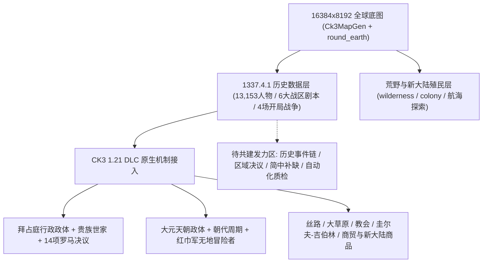

# 《Universalis Kings (EU5_1337_to_ck3)》技术调研与协作共建方案

> **提交人**：`miscos330`（EU5《凤凰计划 / Project Phoenix》作者）  
> **调研基线**：`hathaway682/EU5_1337_to_ck3` `master@f0c287a`（2026-11-25 13:57+08:00） / 对应 CK3 `1.21.* (Florin)`  
> **文档目的**：同步我方对项目现状的技术体检结果、发现的立即可修合并冲突问题，以及后续拟以 **Feature Branch + PR** 方式参与共建的分阶段提案，供作者团队审阅拍板与划分边界，避免与主线开发撞车。

---

## 一、项目现状与已有扎实底座（基于 `master@f0c287a` 核实）

先说整体印象：**这个 1337 全球底盘的工程完成度非常高**，把 EU5 的 1337.4.1 开局完整迁入 CK3 1.21.\* 的工作量非常扎实：

| 维度 | 当前实测基线（`master@f0c287a`） | 亮点评价 |
| :--- | :--- | :--- |
| **全球地图骨架** | 基于 `Ck3MapGen v0.96` 的 `16384×8192` 全球地图（含东西循环 `round_earth`、欧亚非 + 美洲 + 大洋洲） | 已打通荒野政体、殖民政体、航海探索与新大陆发现基础框架 |
| **1337.4.1 历史数据** | 约 **13,153** 位历史人物、`zz_eu5_titles.txt` 超 **60,000** 行头衔沿革、**6 个** 1337 战区剧本、**4 场**开局历史战争 | 百年战争、大元与红巾军、日本南北朝、伊比利亚、巴尔干/拜占庭、中北欧六大舞台已就位 |
| **CK3 1.21 全 DLC 接入** | 拜占庭行政政体（+ MB+ 贵族世家）、大元天朝政体与朝代周期、红巾军无地冒险者营地、丝路/大草原/教会/圭尔夫-吉伯林局势、商贸与新大陆作物商品（`dcfde90`） | 充分利用了 *Roads to Power* / *All Under Heaven* / *Silk and Silver* 等新机制，且 `80_major_decisions_roman.txt`（14 项罗马/拜占庭决议）已在 `52bb369` 恢复启用 |
| **近期主线动态** | `master` 刚合入新大陆商品移植（`dcfde90`）与 `Merge no_innovation`（`a56a9d6`），随后暂回滚了南北朝局势提交（`effb7f3..f0c287a`） | 主线开发聚焦商贸商品、南北朝局势及底层修复 |

---

## 二、优先提醒：刚在 `master@f0c287a` 扫出的 1 个紧急静态问题

在对 `master@f0c287a` 做全量脚本静态审计时，发现 `a56a9d6 (Merge no_innovation)` 合并后遗留了 **6 个文件、共 249 处未解决的 Git 合并冲突标记**（`<<<<<<< HEAD` / `=======` / `>>>>>>> no_innovation`），并直接导致 3 个核心 `.txt` 文件出现括号未闭合，极可能在进游戏时引起头衔/开局主头衔/本地化加载异常：

| 文件路径 | 冲突标记数 | 起始行号示例 | 潜在影响 |
| :--- | :---: | :---: | :--- |
| `common/landed_titles/zz_eu5_titular.txt` | 114（38 处） | L28 | 括号失衡（`+8`），后续头衔定义可能被截断 |
| `common/landed_titles/zz_vanilla_titulars.txt` | 6（2 处） | L2342 | 名义头衔块解析异常 |
| `common/on_action/zz_eu5_primary_titles.txt` | 6（2 处） | L780 | 括号失衡（`+2`），开局主头衔脚本可能中断 |
| `history/titles/zz_eu5_titles.txt` | 117（39 处） | L1723 | 括号失衡（`+1`），1337 头衔归属史可能错位 |
| `localization/replace/english/zz_eu5_politics_l_english.yml` | 3（1 处） | L7460 | 英文政治词条尾部加载中断 |
| `localization/replace/simp_chinese/zz_eu5_politics_l_simp_chinese.yml` | 3（1 处） | L7468 | 简中政治词条尾部加载中断 |

> **说明**：全仓其余 `1,815` 个 `.txt` 脚本括号完全闭合，整体代码非常工整。如作者确认需要，我方可在 **第一个 PR** 优先协助清理这 6 处冲突（或交由作者按 `HEAD` / `no_innovation` 意图自行裁决后我们再基于干净 `master` 开分支）。

---

## 三、全量技术体检：4 大高价值补强空间

### 1. 历史叙事事件链与地区重大决议（最大可玩性增长点）
- **事件层偏薄**：当前 `events/` 下共 **6 个文件**，主要覆盖荒野替换、航海探索（`eu5_colonial_exploration` 7 条、`nwt_voyage` 21 条、`eu5_new_world_discovery` 2 条）及原版重大决议事件；**1337 东罗马/拜占庭、大元/红巾军、百年战争、条顿骑士团、奥斯曼崛起等核心舞台尚无专属历史事件链**。
- **9 个地区重大决议文件仍为 `#AGOT Disabled` 占位空壳**：除 `80_major_decisions_roman.txt` 已恢复外，`00_major_decisions_east_europe`、`00_major_decisions_iberia_north_africa`、`30_mongol_invasion_decisions`、`80_major_decisions_british_isles`、`80_major_decisions_central_asia`、`80_major_decisions_east_asia`、`80_major_decisions_middle_east`、`80_major_decisions_middle_europe`、`80_major_decisions_south_asia` 共 9 个文件仍处于屏蔽状态，可按 1337 地图头衔逐批适配解禁或改写。

### 2. 简中本地化精准补缺
- `master` 已清理大部分 `Ck3MapGen` 的 `gen_*` 英文残留文件，非常清爽；剔除少量剩余 `gen_*` 后，有效业务词条统计为：英文 `67,547` 键 vs 简中 `67,131` 键：
  - **简中缺键 `1,194` 条**：主要集中在荒野殖民/清荒/废墟/开拓者/议会系统（`wilderness_colonization` 550、`wilderness_clearing` 176、`wilderness_pioneer` 95、`ruins` 95、`wilderness_council` 47、`wilderness_colonist` 44 等）及教区/守护圣人系统。
  - **简中仍为英文原文（未汉化）`18,084` 条**：高曝光度的核心条目（如 `zz_mbplus`、`zz_eu5_republic_families`、`zz_eu5_historical_mines`、`zz_ck2_*` 等共数百条）可优先精翻；大批量文化地名/人名表（`eu5_cultural_names`、`zz_eu5_used_name_lists`）可建立对照词表分批校对。

### 3. 原版覆写维护与升级护栏
- 全仓约 `1,400+` 个原版同路径覆写文件中，包含 `common/character_interactions/` 下 **75 个原版交互全量复制文件**（核心差异主要为顶部注入 `tnh_non_wilderness_character_trigger = yes` 防荒野交互）、`game_start.txt`、`4` 个大型 DLC 决议文件及核心 GUI。
- 未来 CK3 更新版本时，如果有一套**自动化静态校验 + 差异补丁重放工具**，可以极大减轻合并冲突与维护负担。

### 4. 与 EU5《凤凰计划》v30.2 的天然 1337 同源协同
我方维护的 EU5《凤凰计划》同样以 **1337 开局**为核心，长期积累了**东罗马帝国（巴列奥略危局、军区行政、帝国复兴）、大元朝局与红巾军/大明历史考据、条顿骑士团东疆史料**，以及**完全原创的 2D 插画/事件图、20 首原创配乐、双语校验与 `dev_test` QA 验收面板**经验。这些都可以按 **CK3 原生人物/家族/行政政体/无地冒险者/局势** 的逻辑重新设计落地，与作者当前主攻的“商贸商品 / 日本南北朝 / 全球底图”形成高度互补、零撞车的分工。

---

## 四、拟议分阶段协作计划（均以独立分支 + PR 交付）

### Phase 0：工程质检地基与干净基线验收
- **交付物**（不侵入游戏运行逻辑）：
  1. 协助核对并清理上述 `master@f0c287a` 的 6 文件合并冲突标记（按作者指定保留策略）；
  2. 提供离线一键校验脚本（检测 Git 冲突标记、UTF-8-BOM 编码、括号配平、EN/ZH 键对齐、`AGENTS.md` 决议/事件写法规范、以及 `error.log` 增量差分）；
  3. 采集干净 `master` 1337 开局的 `error.log` / `setup.log` 基线，作为后续所有 PR “**0 新增报错**” 的硬性门禁。

### Phase 1：中文体验止血与罗马/地区决议校验
- **交付物**：
  1. 补齐非 `gen_*` 的 **1,194 条简中缺失键**（优先荒野殖民/废墟/圣人）及高曝光度未汉化词条（MB+ / 共和国世家 / 历史矿山等），做到核心玩法 100% 汉化；
  2. 对作者刚恢复的 `80_major_decisions_roman.txt` 做全量头衔/区域 ID 实机验收，并输出其余 9 个被禁用地区重大决议文件的《1337 适配评估清单》（明确哪些应恢复适配、哪些应保持禁用）。

### Phase 2：旗舰共建模块一 —— 东罗马 / 拜占庭 1337《凤凰复兴》
- **交付物**（全部采用独立命名空间与独立文件，零污染主线）：
  1. **1337 巴列奥略朝堂与危机事件链（15–25 条）**：围绕安德洛尼卡三世、坎塔库泽诺斯、幼主约翰五世摄政/内战抉择、塞尔维亚杜尚南下与奥斯曼奥尔汗渡海，纯 CK3 人物关系与派系叙事；
  2. **行政政体与帝国中兴决议（基于 *Roads to Power*）**：重整安纳托利亚/巴尔干核心军区辖区、重振瓦兰吉卫队与帝国舰队、五牧首牧区恢复、东西教会合一历史抉择，以及与 `80_major_decisions_roman.txt` 无缝衔接的 1337 罗马复兴链路；
  3. **原创洁净室美术**：仅选用我方 **100% 原创**的 2D DDS 事件插画与决议图标，并按 `CREDITS.md` 规范登记来源。

### Phase 3：旗舰共建模块二 —— 1337 大元危局与红巾军起义
- **交付物**（直接盘活现有 `01_yuan_dynasty.txt` 剧本与已配置人物）：
  1. **元末朝政与黄河水患导火索**：围绕伯颜专权、脱脱更化、贾鲁治河（“石人一只眼”）、纸钞危机，深度联动 CK3 *All Under Heaven* 朝代周期（`tgp_dynastic_cycle`）；
  2. **红巾军群雄起义与逐鹿中原**：直接绑定项目已建好的韩山童（`d_laamp_eu5_rtr_han`）、朱元璋（`d_laamp_eu5_rtr_zhu`）、徐寿辉/陈友谅（`d_laamp_eu5_rtr_xu`）、张士诚（`c_merchant_eu5_rtr_zhang`）、察罕帖木儿（`c_nf_eu5_yuan_chaghan`）等角色，补齐起兵举义、招贤纳士、建立新朝（大明/大汉/大周）或北元退守草原的完整闭环；
  3. 对标项目自身 `situation` 设计规范，同时兼顾玩家手操与纯 AI 30 年观战平衡。

### Phase 4：按需扩展（欧洲风味 / 升级维护工具 / 可选原声包）
- 百年战争开局事件链与条顿骑士团东疆风味（依托现有首次立陶宛十字军）；
- 75 个 `character_interactions` 荒野守卫补丁的自动化差异重建脚本（方便日后升级 CK3 `1.22`）；
- 可选的独立原创原声音乐子模组（不增加主模组体积）。

---

## 五、我方承诺遵守的协作铁律

1. **严守仓库 `AGENTS.md` 规范**：所有新增决议/事件的 `desc` 坚持 CK3 原版叙事风味，绝不把条件/费用/数值塞入描述正文；条件严格走 `is_shown` / `is_valid` / `is_valid_showing_failures_only` / `cost`，辅以精准 `custom_tooltip`。
2. **严守 `CREDITS.md` 与版权边界**：仅提交原创脚本与 **100% 自有原创美术/音乐**；绝不把 EU5 期间第三方单游戏授权素材未经二次书面许可跨游戏搬运进本仓。
3. **零冲突、小步 PR、双语同步、实机验收**：
   - 每个功能独立 Feature Branch + 专属文件前缀，尽量不碰 `00_landed_titles.txt`、`game_start.txt` 等高冲突大文件；
   - 每个 PR 均附带 **简中 + 英文 100% 键对齐**、静态扫描零报错、CK3 实机 `error.log` 相对基线 **0 新增报错**验收回执；
   - 所有依赖 DLC 特性的脚本均加 `has_dlc_feature` 软守卫，严禁对 1.3 万角色做全图月度轮询以保帧率。

---

## 六、请作者确认的 3 个协作细节（确认后即可开干）

1. **文件与命名空间前缀**：我方新增脚本/本地化文件建议统一用什么前缀？例如 `zz_uk_byz_` / `zz_uk_yuan_`（贴合主模组）还是 `zz_phx_`？
2. **首批 PR 优先级与避让区**：
   - 6 个合并冲突文件（`a56a9d6` 遗留）是否需要我方提 PR 协助修复，还是作者您本地正在直接处理？
   - 在 **Phase 1（简中补缺）**、**Phase 2（东罗马/拜占庭）**、**Phase 3（大元/红巾军）** 三者中，您更希望优先推进哪一块？是否有哪块您手头正在重构需要我们避让？
3. **提交流程偏好**：采用 **Fork → 独立分支 → PR 到 `master`**（或您指定的开发分支）是否最方便您审阅合入？
